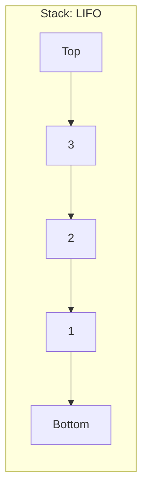
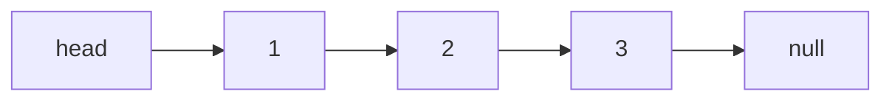
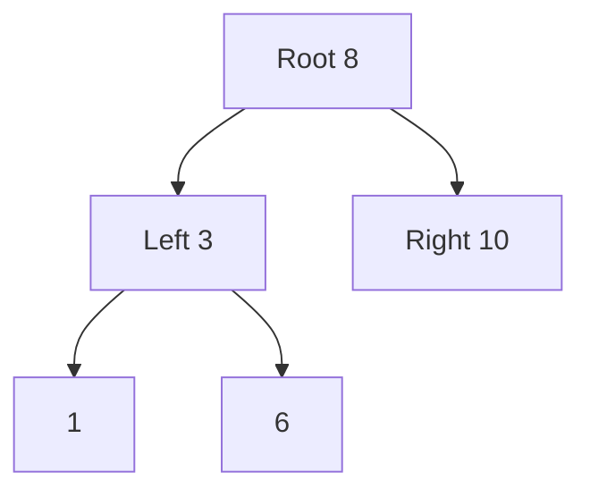
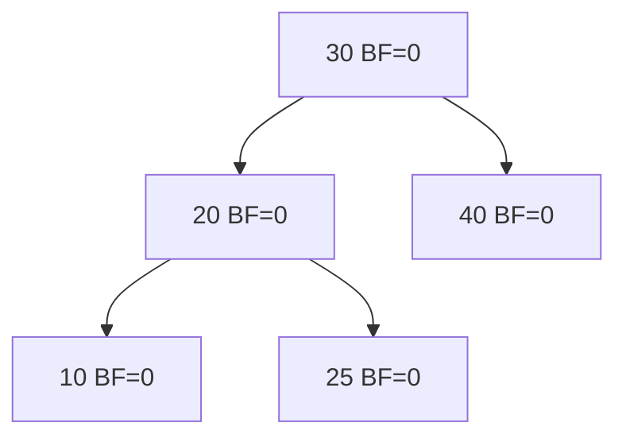
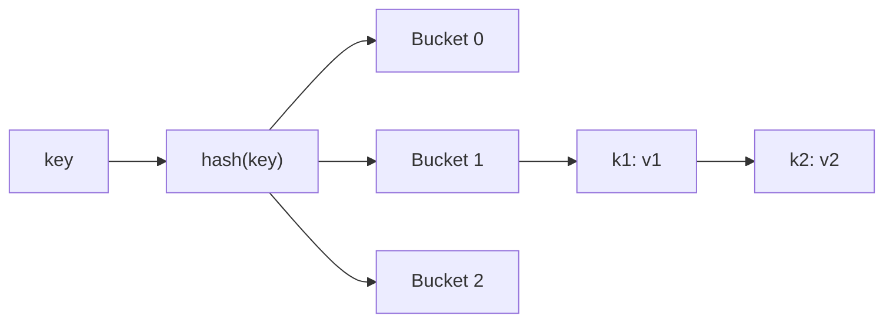
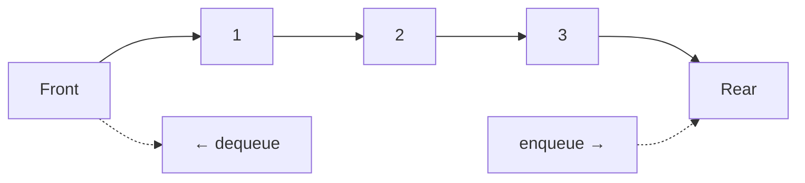
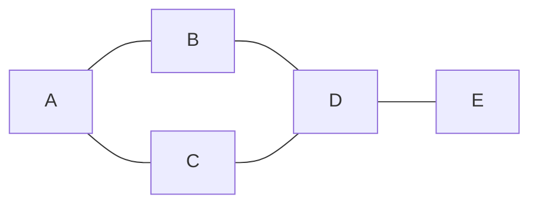
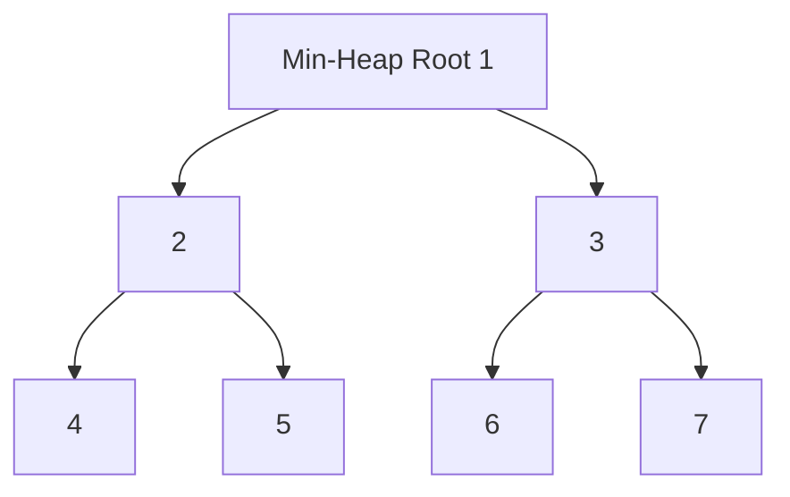
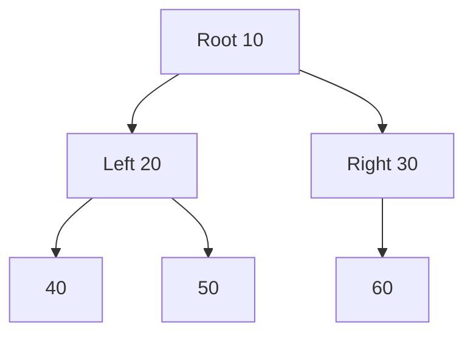
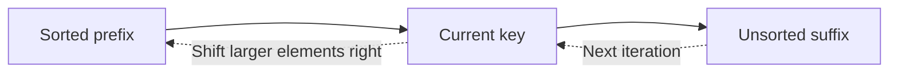

# 📚 Data Structures & Algorithms Quick Reference

> A C-oriented quick reference for common data structures and simple algorithms.  
> Diagrams use Mermaid and render directly on GitHub. If Mermaid is not supported, the text and tables remain readable.

---

## 📋 Complexity Cheat Sheet

### Data Structures

| Data Structure | Access | Search | Insert | Delete | Key Characteristics |
|---|---|---|---|---|---|
| Stack | O(1) top | O(n) | O(1) | O(1) | LIFO: last in, first out |
| Linked List | O(n) | O(n) | O(1)* | O(1)* | Nodes connected by pointers |
| Binary Tree | O(log n) average | O(log n) average | O(log n) average | O(log n) average | Ordered hierarchical structure |
| AVL Tree | O(log n) | O(log n) | O(log n) | O(log n) | Self-balancing binary search tree |
| Hash Table | — | O(1) average | O(1) average | O(1) average | Key-value mapping with collision handling |
| Queue | O(1) front | O(n) | O(1) | O(1) | FIFO: first in, first out |
| Graph | — | Depends on representation | O(1) add edge | O(1) / O(degree) | Represents entities and relationships |
| Binary Heap | O(1) root | O(n) | O(log n) | O(log n) extract root | Complete tree; priority queue |
| Leftist Heap | O(1) root | O(n) | O(log n) | O(log n) | Mergeable heap; leftist property |

> \* Linked list insertion/deletion is O(1) once the target position is already known; finding that position still requires O(n).  
> A plain binary search tree may degrade into a linked list in the worst case, making operations O(n).

### Algorithms

| Algorithm | Best | Average | Worst | Space | Stable |
|---|---|---|---|---|---|
| Insertion Sort | O(n) | O(n²) | O(n²) | O(1) | Yes |

---

## 🧱 Data Structures

### 1. 🥞 Stack

**Overview**: A stack is a linear structure that follows **LIFO** (last in, first out). Insertion and deletion happen only at the top.  
**Common operations**: `push`, `pop`, `peek`.  
**Typical applications**: Function call stack, bracket matching, expression evaluation, undo operations.

---

### 2. 🔗 Linked List

**Overview**: A linked list consists of nodes. Each node stores data and a pointer to the next node.  
**Common types**: Singly linked list, doubly linked list, circular linked list.  
**Advantages**: Flexible insertion and deletion; no contiguous memory required.  
**Disadvantages**: No random access; searching requires traversal from the head.

---

### 3. 🌳 Binary Tree

**Overview**: Each node has at most two children: a left child and a right child.  
**Binary Search Tree (BST)**: For each node, values in the left subtree are smaller, and values in the right subtree are larger.  
**Typical applications**: Searching, sorting, expression trees, file system directory structures.

---

### 4. ⚖️ AVL Tree

**Overview**: An AVL tree is a self-balancing binary search tree. For every node, the absolute height difference between its left and right subtrees is at most 1.  
**Balance factor**: `height(left subtree) - height(right subtree)`, with values -1, 0, or 1.  
**Balancing operations**: Left rotation, right rotation, left-right rotation, and right-left rotation.  
**Advantage**: Search, insertion, and deletion are guaranteed to stay O(log n).

> `BF` means balance factor. AVL trees use rotations to avoid the degeneration seen in plain BSTs.

---

### 5. 🗂️ Hash Table

**Overview**: A hash table maps keys to buckets in an array using a hash function, enabling fast key-value lookup.  
**Collision handling**: Separate chaining, open addressing, and other strategies.  
**Advantages**: Average search, insertion, and deletion are close to O(1).  
**Disadvantages**: Worst-case performance may degrade to O(n); a good hash function and resizing strategy are important.

---

### 6. 🚶 Queue

**Overview**: A queue is a linear structure that follows **FIFO** (first in, first out). Elements enter at the rear and leave from the front.  
**Common operations**: `enqueue`, `dequeue`, `front`.  
**Variants**: Circular queue, double-ended queue, priority queue.  
**Typical applications**: Task scheduling, message queues, breadth-first search (BFS).

---

### 7. 🕸️ Graph

**Overview**: A graph consists of vertices and edges, representing relationships between objects.  
**Categories**: Directed/undirected, weighted/unweighted, connected/disconnected.  
**Common representations**: Adjacency matrix, adjacency list.  
**Common algorithms**: DFS, BFS, Dijkstra, topological sorting.  
**Typical applications**: Social networks, map navigation, dependency graphs, recommendation systems.

---

### 8. 🧺 Binary Heap

**Overview**: A binary heap is a complete binary tree that satisfies the heap property. In a min-heap, every parent is less than or equal to its children.  
**Common operations**: `peek` root, `insert`, `extract min/max`.  
**C implementation note**: A binary heap is usually stored in an array. For 0-based indexing, the children of index `i` are `2i + 1` and `2i + 2`.  
**Typical applications**: Priority queues, heap sort, scheduling, top-k problems.

> Array representation: `[1, 2, 3, 4, 5, 6, 7]`.

---

### 9. 🌿 Leftist Heap

**Overview**: A leftist heap is a mergeable heap structure. It is a binary tree that satisfies the heap property and the **leftist property**.  
**Leftist property**: For every node, `npl(left child) >= npl(right child)`, where `npl` is the null path length.  
**Core operation**: `merge`. Insertion and deletion can both be implemented using merge.  
**Advantage**: Efficient merging in O(log n).  
**C implementation note**: Each node typically stores a rank or `npl` value to maintain the leftist property.  
**Typical applications**: Priority queues that require efficient merge operations, graph algorithms, event simulation.

> The left subtree is kept at least as “heavy” as the right subtree according to null path length.

---

## ⚙️ Algorithms

### 10. 🔃 Insertion Sort

**Overview**: Insertion sort builds a sorted prefix one element at a time. It takes the current key and shifts larger elements to the right until the correct position is found.  
**Characteristics**: Stable, in-place, simple to implement.  
**Best case**: O(n) when the array is already nearly sorted.  
**Average / worst case**: O(n²).  
**Typical applications**: Small arrays, nearly sorted data, simple teaching examples.

> C implementation hint: use a loop to compare the current key with elements in the sorted prefix and shift them right.

---

## ✅ Summary

- **Stack / Queue**: Restricted linear structures with LIFO and FIFO behavior.
- **Linked List**: Pointer-based structure with flexible insertion/deletion but weak random access.
- **Binary Tree / AVL Tree**: Hierarchical search structures; AVL trees maintain balance through rotations.
- **Hash Table**: Trades space for time, with average O(1) lookup.
- **Graph**: The most expressive structure for modeling complex relationships.
- **Binary Heap**: Complete tree stored in an array; ideal for priority queues.
- **Leftist Heap**: Mergeable heap with O(log n) merge, insert, and delete.
- **Insertion Sort**: Simple stable sorting algorithm; efficient for small or nearly sorted arrays.

> Selection advice: first identify the operation pattern (LIFO / FIFO / key-value / relationships / priority / merging), then consider the required frequency and ordering of search, insertion, and deletion.